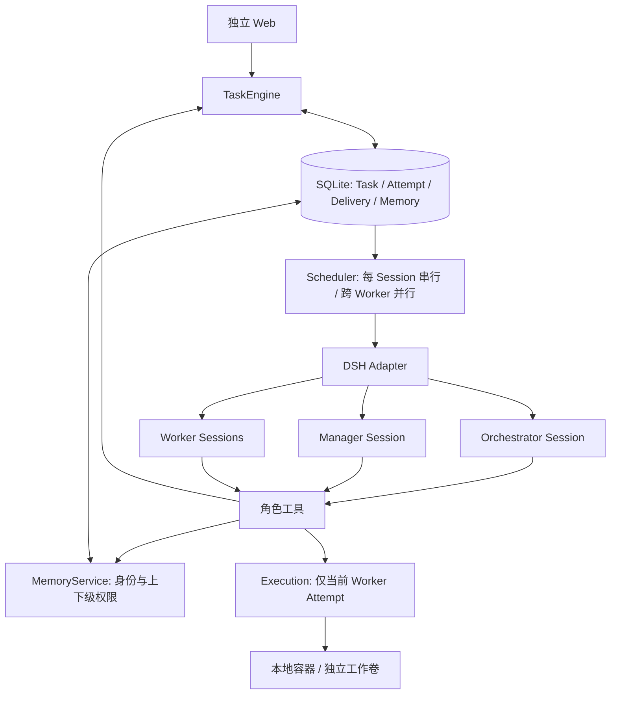

# 架构与阶段边界

Agent Studio 在 DSH 仓库外作为独立应用和 Bundle 开发。DSH 提供原生模型回合、Session、请求日志和工具执行；Studio 的确定性编排服务拥有组织、任务和持久调度。本文描述第三阶段的记忆与本地执行设计；动态联网、可信工具安装和完整任务依赖图仍属后续范围。

## 持久任务与非抢占调度

Task/Attempt、SQLite 持久任务投递和执行中追加任务继续作为所有能力的调度基础。新任务必须独立建档；普通追加不取消正在运行的模型请求、不修改当前任务目标、不占用正在工作的 Worker。任务被接收不等于开始执行，也不等于完成验收。SQLite 三层记忆始终启用；Worker 的容器执行由宿主显式配置不可变镜像后启用，未启用时保留无副作用 probe。外部网络和动态工具安装没有开放。

验收覆盖：Worker A 尚未结束时追加 B，A 的请求不被取消且任务和结果保持原样；资源允许时 B 使用另一 Worker 并行，否则持久排队；指定 Manager 时不直接向其开放用户聊天；停止进程后未完成投递可恢复；同一提交 ID 不重复创建任务；执行失败后重试保存新的 Attempt 而不覆盖历史；验收重试保留已报告的 Attempt；新 Run 创建新的 Session。

## 领域对象与组织

| 对象 | 职责 |
| --- | --- |
| Run | 一次协作过程，拥有唯一 Orchestrator、成员和多个独立 Task |
| AgentTemplate | 可复用配置；版本更新仅影响新实例 |
| AgentInstance | Run 内成员，拥有独立配置快照和 DSH Session；组织由 parentId 决定 |
| Task | 目标、协调者、请求 ID、业务状态、结果与当前执行尝试 |
| Attempt | 某个 Worker 承担的一次执行，记录开始、终止和报告；重新执行产生新记录，投递退避与验收重试不另建执行记录 |
| Delivery | 已提交的任务、报告、结果或消息，包含稳定 ID、收件人、投递状态和重试信息 |

组织树与任务状态独立。每个 Run 只有一个 Orchestrator，合法组织为 O → Worker 或 O → Manager → Worker。一个 Manager 可以管理多个 Task，一个 Worker 同时只承担一个活跃 Attempt。相同模板可创建多个 Worker；复用必须明确选取空闲成员，不由模板相同隐式决定。Agent 业务 ID 与 Session ID 分别保存，不把模板 ID 当作记忆授权身份。

## 编排与 DSH 集成

HTTP 和模型工具调用同一 TaskEngine；它校验真实调用者、Run 及直属关系，事务性保存业务状态和待投递消息。Scheduler 在提交后驱动 DSH Adapter。模型提出规划和委派，程序校验权限、执行状态迁移、资源上限和去重。Orchestrator/Manager 不拥有 shell、文件或网络执行工具。

协调者完成一次派工后结束当前回合，等待结果事件。新增任务只排入收件箱，在收件人空闲的安全时点投递；不向运行中的回合插入新的任务指令。报告同样经持久队列串行送达，不使用可能改变当前回合的即时 steering。DSH 管理每个成员的独立会话，Studio 的组织记录负责业务管辖与报告路由，避免将原生子 Agent 的自动通知当作任务调度器。

## 新任务、补充消息与停止

新 Run 表示独立目标并建立全新 Orchestrator Session。当前 Run 内追加工作创建新的 Task，可请求路由到现有 Manager；该请求归属于 Orchestrator 管理的任务入口，用户仍仅与 Orchestrator 对话。聊天补充不静默变成新任务，界面明确区分两种操作。

普通追加不触发 cancel、interrupt 或 steer。资源不足时 Task 保持 queued，任务列表显示等待；资源允许时不同 Worker 并行。相同 Agent Session 的模型回合始终串行。每个 Attempt 拥有独立 Docker 工作卷，两个 Worker 不共享文件系统。重试创建新 Attempt 和新工作卷，旧卷保留供只读查看；同一 Attempt 的文件和命令操作串行。

取消 Task 仅针对其执行尝试和相关未投递消息；停止 Run 才取消整个 Run。服务关闭会停止接收和调度，保存未完成记录；重启恢复与用户主动取消是不同语义，取消的任务不能自动复活。

## 状态、报告与恢复

Task 的 queued/running/review/completed/blocked/failed/cancelled 是业务状态；Agent 的 running/idle/dormant 是会话状态。Worker 空闲不自动表示 Task 已完成。Worker 提交带 Attempt ID 的报告，协调者明确验收后才能完成任务。旧 Attempt 的迟到报告不能覆盖新的尝试。协调者未委派或未验收即结束回合时必须留下可见的等待或阻塞状态。

SQLite 同一事务保存业务变化和待执行 Delivery。调度器按收件人有序执行，稳定消息 ID 用于去重；重试预算和错误可见且持久。DSH Session 日志用于核验消息是否进入历史以及回合是否完成。进程中断后的未确认工作先对账再恢复；中断的执行尝试保留历史，恢复产生新的尝试及恢复说明。不得因有持久队列就宣称文件或网络操作恰好执行一次。

schema 升级采用事务，未知版本拒绝启动。同一数据目录只有一个实例持有运行权，迁移前先取得独占权。第一阶段历史 Run 和 Session 保留为历史数据，不凭已有聊天内容虚构已验收的 Task。

## 配置和本阶段范围

继续使用已验证的本机 DSH 公开包和 compatibility.json，不修改或构建 DSH 源码。模型配置保持只读导入，独立 prompt/model/reasoning 快照在新成员创建时冻结。默认演示 provider 只用于验证协作流程；真实模型行为须另行验证。

调度并发和演示延迟通过已校验的应用配置提供，便于观察和验证追加行为。整个系统暂时保持一个外部包和一个宿主进程，SQLite 承担业务存储及操作队列，不增加独立消息服务。显式长期身份复用已接入；后续任务依赖图、完整产物验收和跨执行组工作流在这个基础上扩展。

## SQLite 三层记忆与渐进式披露

| 层级 | 内容与生命周期 | 披露方式 |
| --- | --- | --- |
| 长期记忆 | 跨任务的方法论、稳定规范和有依据的经验；分公开与私有空间 | 先看主题和摘要，再按需展开 |
| 中期记忆 | 当前 Run/Task 的目标、约束、决策、阶段结果与证据索引；任务结束后归档 | 按任务、主题和状态检索 |
| 短期记忆 | 当前进度、已完成项、下一步、阻塞和恢复位置 | 压缩或恢复后先读最新检查点 |

长期记忆的最终所有者使用独立的持久 Agent 身份，不直接等同于模板 ID。同一模板派生不同岗位时分配不同身份；跨任务明确复用同一身份才延续其私有长期记忆，避免不同执行组因共用模板而共享私有内容。新建 Run 可明确选择长期记忆来源 Run；协调者只能从对应历史父成员的直属子成员中选择复用身份。角色和模板须一致，同一 Run 禁止重复绑定同一个子成员身份。未明确选择时，Worker 使用全新私有身份；Orchestrator 默认沿用自己的模板身份。

公开长期记忆是系统共享方法论，全员可读；私有长期记忆绑定 Agent 的稳定身份，跨任务保留。新建 Run 时复用模板和明确选择的长期记忆身份，创建新 Session，不自动继承其他 Run 的中期或短期内容。Run 内追加 Task 保留现有协调者 Session，默认创建独立 Worker Session。

权限以真实调用 Agent 的身份和组织关系计算：Agent 可读写自身记忆；Orchestrator 可读取所有后代记忆；Manager 可读取自己执行组内 Worker 的记忆；Worker 不可读 Manager，Manager 不可读 Orchestrator，不同执行组之间也不可直接读取私有记忆。上级读取权不自动授予改写下级记忆的权限。公开内容须经过显式发布，不能因长期保存就变成全员可见。

SQLite schema 3 保存记忆条目、不可变修订、所有者、层级、Run/Task 范围、摘要及允许/拒绝访问审计。工具入口包括目录/搜索、分页正文、写入、检查点及显式公开长期条目。目录、搜索命中、计数和正文都先在 SQL 查询中做授权过滤。每页目录默认 8 条、最多 20 条；摘要最多 240 字符；正文默认读取 2,000、最多 4,000 字符。写入要求非空内容，更新必须提供预期版本；访问审计不保存记忆正文。

Agent 自行调用工具读写记忆。运行时将可见层级数量与最新检查点引用作为原生可回放消息提供，不自动注入正文。复用 DSH 公开 TokenMeter/BasicCompaction 组件压缩上下文，压缩完成后追加同一 Task/Attempt 的恢复入口；Agent 按需读取检查点。恢复时结合检查点、任务表和原生日志确认真实状态；检查点不替代 Task/Attempt 状态。

## 本机容器与代码、文件执行

Worker 的 `studio_exec`、文件读写和目录工具连接本地 Docker，只有当前 Worker 的运行中 Attempt 能执行。宿主根据真实 Session、Task 和 Attempt 验证调用者，再将固定执行身份交给 provider；模型不能指定宿主路径、挂载、镜像、网络模式或 Docker 参数。Orchestrator/Manager 没有执行权限。Web 只提供成果目录和分页正文读取，不开放命令或写文件接口。

每个 Attempt 使用独立命名工作卷，每次操作启动一个容器并在结束后删除容器；工作卷保留。容器使用非 root 用户、只读根文件系统、全部 capability 移除、no-new-privileges、关闭网络及 CPU/内存/PID/超时/输出限制。仅挂载自己的工作卷，不挂载宿主 HOME、业务仓库、SQLite、Session 日志、模型凭据或 Docker socket。宿主只启动固定 Docker CLI，模型提供的命令在容器内执行。

代码执行返回退出码、超时、取消、输出超限以及有界 stdout/stderr，独立报告各项结果。取消和超时结束整个操作容器并等待退出。初始化清理带本数据目录所有权标签的遗留容器，保留成果卷，不触碰其他 Docker 服务。文件工具只接受工作卷相对路径，并在容器内拒绝路径中的符号链接、非普通文件及父目录逃逸；读取使用有界分页。

镜像必须由宿主明确选择已存在的不可变 ID/digest，运行时不自动拉取。可信工具可以预先安装进经过审核的镜像；本阶段没有向 Agent 开放包安装、动态网络或 Docker 管理接口。以后接入可信工具安装时，应分别控制构建流量和任务流量，记录来源、版本、校验值及镜像产物，继续保留宿主与容器隔离。

Docker 的进程、挂载与资源控制语义参考 [运行容器](https://docs.docker.com/engine/containers/run/) 和 [持久卷](https://docs.docker.com/engine/storage/volumes/)。本项目验收以实际 Docker 配置检查和执行结果为依据，不把参数存在视为所有潜在容器逃逸风险已消除。
